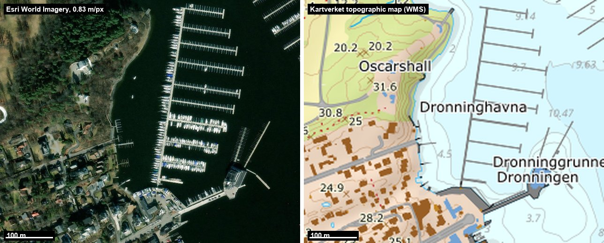
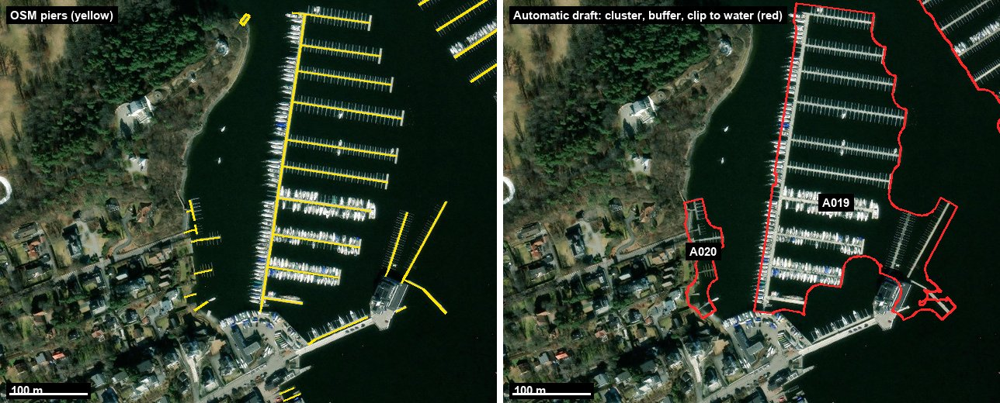
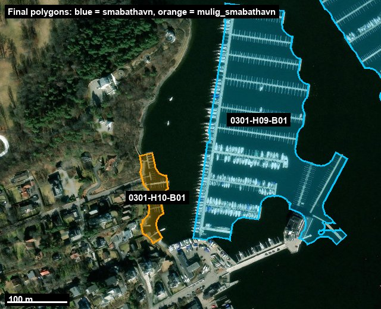

# Small-boat harbours in the Oslofjord

Polygons with traceable metadata for small-boat harbours (marinas, boat club harbours and other shared berthing facilities) in the municipalities bordering the inner and outer Oslofjord, Norway.

Approved status: **630 polygons from 20 municipalities** (Holmestrand, Horten, Tønsberg, Færder, Sandefjord, Larvik, Moss, Råde, Fredrikstad, Bærum, Asker, Lier, Drammen, Oslo, Nordre Follo, Nesodden, Frogn, Vestby, Hvaler, Bamble). Remaining: Sarpsborg, Halden, Porsgrunn (Ås not yet confirmed as coastal). See `status.json`.

**Explore it in 3D:** [www.oceandatajo.com/labs/oslofjord-bathavner](https://www.oceandatajo.com/labs/oslofjord-bathavner). The site is in `site/`, and its data is built with `scripts/build_flyover_data.py`. The dataset will be published on the [Ocean Data Platform](https://app.hubocean.earth/) from [HUB Ocean](https://www.hubocean.earth/).

The dataset is an imagery- and source-based mapping. It does not show official harbour or property boundaries. Approval does not remove uncertainty about classification or geometry.

## Analysis method

The full methodology and the per-municipality logs are in [`docs/METODIKK.md`](docs/METODIKK.md) (Norwegian). Summary of method version 1.2, used from Fredrikstad onwards:

### What counts as a small-boat harbour?

| Class | Rule |
|---|---|
| `smabathavn` (harbour) | Shared facility with at least 10 berths, or a documented marina or boat club with permanent berths |
| `mulig_smabathavn` (possible harbour) | Several connected piers, but the number of berths or the shared operation is unclear |
| Excluded | Scattered private piers, bathing piers, ferry quays, slipways, plain breakwaters, planned facilities |

The ten-berth threshold is a project rule, not a legal definition. A club's postal address does not prove where its harbour is, and a zoning plan area is not an existing harbour.

### Workflow per municipality

1. **Boundary and coverage.** The municipal boundary comes from the Norwegian Mapping Authority (Kartverket). The shoreline is divided into tiles. For each tile, aerial imagery (Esri World Imagery, about 0.7–0.8 m/pixel) and a topographic map (Kartverket WMS) are stored with georeferencing in EPSG:25833.
2. **Candidate search from two independent sources.**
   - *Map:* OpenStreetMap piers, marinas and moorings from Overpass.
   - *Sources:* the Central Coordinating Register for Legal Entities (boat clubs, marinas), Kartverket place names, municipal harbour pages and other public documents.
3. **Automatic draft.** OSM piers within 60 m of each other are clustered. Each cluster is buffered by 12 m and closed by 20 m. The result is clipped to the water area of the topographic map and to the municipal boundary. This is only a draft geometry.
4. **Visual review of every candidate.** The draft is drawn on top of the aerial image. Each candidate gets one decision: include, clip, split, add a manual area, draw manually, or exclude. Every decision has a stated reason and is recorded in `decisions.py` and the candidate ledger.
5. **Systematic imagery sweep.** All detail tiles near the fjord are reviewed in contact sheets with the candidates overlaid, to find harbours missing from OSM. These are drawn manually.
6. **Polygon rule.** A polygon covers the piers, the berths and the water between them. It does not cover the whole bay, land areas or the club's property. Separate parts become separate polygons that share a `harbour_id`. Harbours that cross a municipal boundary are clipped, flagged with `municipality_clipped` and linked through `cross_municipality_group_id`.
7. **Quality control.** Every exported polygon is checked as an overlay on the aerial image after the last edit. The delivery is also validated for:
   - valid geometry
   - unique IDs
   - fit to the municipal boundary
   - no overlap with other polygons or with the combined file
   - CSV matching the GeoJSON
8. **Approval.** The user approves each municipality, or an agreed batch, by inspecting the GeoJSON file. Only after approval is the delivery copied to `data/kommuner/<code>-<name>/rev-NN/` and merged into the combined file. Uncertain boundaries and open candidates are kept. New findings in already approved municipalities go to a separate pending log (`neighbour-pending.json`).

Each polygon row records, among other things:
- the classification and its basis
- the method field (OSM-based or drawn manually)
- sources and OSM IDs
- the imagery source and its resolution
- a flag for uncertain boundaries (`needs_orthophoto_review`)

Wall-clock time is recorded per municipality in `timing.json`. Field names and values are in Norwegian.

### Worked example: Dronninghavna, Bygdøy (Oslo)

**Raw data.** Each detail tile (1.1 × 1.1 km) is stored with its EPSG:25833 bounding box, retrieval date and SHA-256 checksum. The aerial image shows the physical structures. The topographic map gives the shoreline and water area used for clipping, plus place names.



**Automatic draft.** OSM piers (left) are clustered and turned into candidate polygons (right). A019 is the main marina and A020 is a group of short piers along the Bygdøy shore. The draft follows the piers. It can still include too much water or miss berths along quays, so a person reviews every candidate against the image.



**Final polygons after review.** A019 was accepted as a harbour, because many berths with finger piers are clearly visible. A020 was kept but classified as a *possible* harbour. The piers have boats, but it is unclear whether they are shared with the club or private. Its boundary is flagged as uncertain.



**Metadata.** Each polygon is one row in the GeoJSON and in the metadata CSV. Selected fields for the two polygons:

| Field | `0301-H09-B01` | `0301-H10-B01` |
|---|---|---|
| `name` | Dronninghavna – Kongelig Norsk Seilforening | Dronninghavna vest – mindre brygger |
| `name_is_descriptive` | `false` (actual name) | `true` (descriptive name we made up) |
| `classification` | `smabathavn` | `mulig_smabathavn` |
| `classification_basis` | `minst_10_synlige_plasser_i_sammenhengende_anlegg` (≥10 visible berths in one facility) | `flere_brygger_men_felles_drift_eller_kapasitet_uklar` (several piers, shared operation or capacity unclear) |
| `method` | `osm_pirer_bufret_og_klippet_mot_kartvann_bildekontrollert` (OSM piers buffered, clipped to map water, checked against image) | same |
| `geometry_status` / `needs_orthophoto_review` | `forelopig_avgrensning` (provisional) / `false` | `usikker_avgrensning` (uncertain) / `true` |
| `area_m2` | 58 866.7 | 4 197.6 |
| `osm_ids` | 23 piers (`way/27767772`, …) | 8 piers (`way/114200485`, …) |
| `image_id`, `image_resolution_m_per_pixel` | `d-c259-6649`, 0.833 | `d-c259-6649`, 0.833 |
| `source_observation_date` | `null` (acquisition date unknown) | `null` |
| `current_operation_verified` | `false` | `false` |
| `note` | Long pier with many finger berths and breakwater | Short piers with boats on the Bygdøy side; may belong to the club or be private |

The candidate ledger (`candidate-ledger.csv`) keeps a row for every candidate, including excluded ones, with the decision and reason. Excluded candidates therefore stay traceable.

The figures were made with `work/0301-oslo/readme_figures.py`. It needs the local images, which are not stored in git.

### Known limitations

- Image acquisition dates are unknown. A structure is shown to exist, but not that it is in use today.
- OSM piers can be offset from the imagery. Boats moored along quays without an OSM pier can fall outside the polygon.
- Visual analysis can miss small facilities. No field survey or land surveying has been done.
- Holmestrand and Horten are earlier map-based pilots and have not been re-checked with the current method.

## Getting started

```bash
git clone https://github.com/joevstaas/oslofjord-bathavner.git
cd oslofjord-bathavner
python3 -m venv .venv
source .venv/bin/activate
python -m pip install -r requirements.txt
python scripts/validate_project.py   # expects 456 polygons / 14 municipalities
claude
```

Requires Python 3.11 or newer. Claude Code is installed separately.

Aerial images, raw downloads and QA sheets for approved municipalities are not in git (see `.gitignore`). They are only needed to revise an approved municipality and can be fetched again. After cloning, the validation script therefore reports 0 municipalities with original imagery.

## Contents

- `data/samlet/`: the approved combined file (GeoJSON, WGS84) and its manifest.
- `data/kommuner/<code>-<name>/rev-NN/`: approved municipal deliveries with metadata CSV, candidate ledger, decisions, open candidates, coverage and timing.
- `status.json`: current status with relative paths.
- `docs/METODIKK.md`: the authoritative methodology and municipal logs. `docs/OVERLEVERING.md`: file map and handover notes.
- `CLAUDE.md`: project instructions for Claude Code.
- `work/`: analysis scripts per municipality. The most recent one (`0301-oslo`) is the template for the next.
- `archive/original/`: historical deliveries, notes and scripts for the first municipalities.
- `scripts/validate_project.py`: local check that needs no network.

Sources: © Kartverket; Esri, Vantor, Earthstar Geographics and the GIS User Community; © OpenStreetMap contributors (ODbL); Brønnøysund Register Centre (Enhetsregisteret).

Created by [Jo Øvstaas](https://github.com/joevstaas).

## Moss harbour information pilot

Moss harbour cards include a separate source review of operator identity, reported capacity and services where documented. Each fact links to its source and distinguishes the retrieval date from an unknown reference date. Ordinary, guest, dinghy and land-storage places remain separate; earlier dataset capacities are available as historical context. Current operation and wastewater treatment have not been verified. Approved geometry and harbour classification are unchanged.

The structured review covers 22 harbours and is documented in [the Moss enrichment pilot](data/berikelse/3103-moss/pilot-01/README.md). Build the optional website overlay with `python scripts/build_harbour_enrichment.py`; `scripts/build_flyover_data.py` also invokes it. The map remains usable if the optional overlay cannot load. Local third-party source snapshots are excluded from Git; structured observations, source URLs and hashes are retained.
